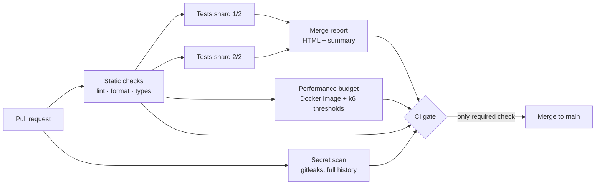

# playwright-ci-reference

A small, complete reference of **how a test suite becomes a quality gate**: layered Playwright tests, a CI pipeline on GitHub-hosted runners, and the engineering decisions behind them.

The system under test is a tiny demo shop that lives in this repo (`app/`), so everything runs offline and the results are deterministic. The point is not the shop: it is the way the tests are built, run, reported and enforced.

## What the pipeline does



| Concern             | How it is solved here                                                                                                                                                                                                                                                                                                           |
| ------------------- | ------------------------------------------------------------------------------------------------------------------------------------------------------------------------------------------------------------------------------------------------------------------------------------------------------------------------------- |
| Fast feedback       | Tests run in 2 parallel shards; browsers are cached per Playwright version; a newer push cancels stale runs                                                                                                                                                                                                                     |
| One source of truth | Sharded blob reports are merged into a single HTML report plus a Markdown summary on the run page                                                                                                                                                                                                                               |
| Debuggable failures | Traces on first retry, screenshots and video on failure, uploaded as artifacts                                                                                                                                                                                                                                                  |
| Flakiness           | One retry in CI; tests that pass only on retry are reported as **flaky**; a nightly run repeats the suite 3×                                                                                                                                                                                                                    |
| Evidence            | PR runs keep traces, screenshots and video only for failures (fast, light). The nightly run records a full trace for every test, so its published report has evidence even when everything passes. Traces include request bodies: the login password is ephemeral per run and belongs to a demo app, so nothing real is exposed |
| Performance         | A k6 test runs against the app built from the `Dockerfile` and enforces error-rate and latency thresholds (p95/p99); crossing one fails the gate. Budgets are deliberately generous for shared runners                                                                                                                          |
| Secrets             | No credentials in the repo. Test credentials are generated per run, masked in logs; gitleaks scans the whole history on every PR                                                                                                                                                                                                |
| Supply chain        | Every third-party action is pinned to a commit SHA (version in a comment); workflows run with read-only permissions by default                                                                                                                                                                                                  |
| Enforcement         | One required status, `CI gate`, so adding or renaming jobs never breaks branch protection                                                                                                                                                                                                                                       |

## Project layout

```
app/                  Demo shop (zero-dependency Node server + static UI)
tests/
  fixtures.ts         Fixtures: page objects, signed-in state, authenticated API client
  pages/              Page objects (locators and actions, with assertion helpers named expect*)
  ui/                 Browser tests: behaviour a user cares about
  api/                Contract tests: status codes, validation, isolation between sessions
scripts/summary.mjs   Turns the JSON report into a Markdown table for the run page
.github/workflows/    ci.yml (PR gate) and nightly.yml (full run, optional Pages publish)
perf/                 k6 performance test with thresholds
Dockerfile            The demo shop as a container image
docs/adr/             Short decision records
```

## Run it locally

```bash
npm ci
npx playwright install chromium     # or set PW_CHANNEL=chrome to use an installed Chrome
npm run check                       # lint + format + typecheck + all tests
npm run report                      # open the last HTML report
```

Optional: run the performance budget locally (needs [k6](https://grafana.com/docs/k6/latest/set-up/install-k6/) and Docker):

```bash
docker build -t shop-app .
docker run -d --name shop -p 3100:3100 -e APP_USER=demo -e APP_PASSWORD="$(openssl rand -hex 12)" shop-app
APP_USER=demo APP_PASSWORD=<same password> npm run perf
docker rm -f shop
```

Credentials are optional locally: if `APP_USER` / `APP_PASSWORD` are not set, a random pair is generated for that run (see `.env.example`).

## Test design in short

- **Fixtures over setup code.** `signedInShop` starts a test already at the state it cares about; `authedApi` gives an authenticated API client. Tests read as intent, not procedure.
- **Locators by role and label**, never CSS chains; ESLint (`eslint-plugin-playwright`) forbids fixed waits, forced actions and non-web-first assertions, and fails on any warning.
- **API tests for rules, UI tests for flows.** Validation, error codes and session isolation are checked at the API layer (milliseconds); the UI layer only covers what a user does.
- **Independent tests.** Each test owns its session, so `fullyParallel` is safe and sharding needs no coordination.

## Enable the gate on your fork

1. Push to GitHub and let `CI` run once on a pull request (the check names appear after the first run).
2. Settings → Branches (or Rulesets) → protect `main`:
   - Require a pull request before merging.
   - Require status checks to pass → select **`CI gate`** only.
   - Require branches to be up to date before merging.
3. Optional: Settings → Pages → Source "GitHub Actions", then add the repository variable `PUBLISH_REPORT=true` to publish the nightly report.

## Decisions

- [ADR 1 — A hermetic demo app instead of a public site](docs/adr/0001-hermetic-demo-app.md)
- [ADR 2 — Shard in CI and merge the reports](docs/adr/0002-shard-and-merge-reports.md)
- [ADR 3 — One required check and SHA-pinned actions](docs/adr/0003-single-gate-and-pinned-actions.md)
- [ADR 4 — Performance budget in CI with k6, app run as a container](docs/adr/0004-performance-budget-in-ci.md)

## Scope and limits

This is a reference, not a product. It shows the mechanics on GitHub-hosted runners; it does not cover self-hosted runners, cross-browser matrices, visual regression or test-data services, which are natural next steps.
